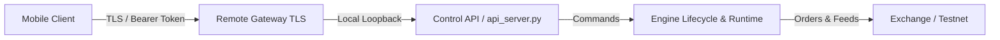

# QuantEngine Phase 162 API, Mobile Control, and Observability Status

## Executive Summary
This document audits the control API, mobile control architecture, authentication boundaries, monitoring metrics, and deployment readiness in QuantEngine Phase 162.

---

## Control Architecture & Security Model

### Security Precepts
1. **Zero Exchange Secrets on Mobile**: The mobile client or external controller NEVER receives or stores exchange API keys or secrets. It connects exclusively to the QuantEngine Control API.
2. **Local Loopback Binding**: The core Control API binds exclusively to `127.0.0.1` (localhost). External access is mediated only by the dedicated TLS Remote Gateway (`core/remote/service.py`) when explicitly enabled.
3. **Constant-Time Authentication**: Bearer tokens are validated using `hmac.compare_digest` to prevent timing attacks.
4. **Secret Redaction**: Any exception raised during command handling has potential API keys, passwords, or tokens redacted before formatting error responses.

---

## API Surface and Endpoints

### Read Endpoints (`GET`)
- `/health`: Service liveness, feed freshness, and engine status.
- `/status`: Engine runtime state (`READY`, `PAPER_RUNNING`, `PAUSED`, `STOPPED`).
- `/performance`: Realized PnL, win rate, average R:R, and drawdown metrics.
- `/positions`: Current open positions, entry prices, mark prices, and unrealized PnL.
- `/orders`: Active and historical orders with bracket stop/target details.
- `/ledger`: Append-only trade transaction log.
- `/subscriptions`: Active market data channels and symbol subscriptions.

### Control Endpoints (`POST /control`)
- **Restricted Hard Allowlist**: Only the following explicit verbs are permitted:
  - `start`: Starts the paper trading pipeline.
  - `stop`: Gracefully stops the engine after managing open positions.
  - `restart`: Gracefully restarts engine subsystems.
  - `pause` / `resume`: Suspends new signal evaluation without closing existing trades.
  - `emergency_stop`: Immediate kill switch; cancels all open orders and flattens all positions at market.
- **No Direct Order Submission**: There is no endpoint permitting a mobile user or external HTTP caller to arbitrarily inject order sizes, limits, or bypass risk filters.

### Risk Policy Endpoints (`GET/POST /risk-policy`)
- Allows operator to adjust risk limits within hard server-side boundaries:
  - Minimum R:R floor: $\ge 1.0\text{R}$
  - Maximum R:R ceiling: $\le 20.0\text{R}$
  - Sizing limits: $\le$ configured maximum lot ceiling.
  - Invalid inputs return `400 Bad Request` and are discarded.

---

## Observability, Supervision, and Logging

### Structured Logging
- Uses Python `logging` with structured, non-secret log format (JSON / key-value).
- All sensitive environment variables (`DELTA_API_KEY`, `DELTA_API_SECRET`, `CONTROL_API_TOKEN`) are filtered from log outputs.

### Operational Metrics
- Feed Latency: Monitored via exchange event timestamps vs receipt epoch.
- Feed Freshness: Alert raised if feed becomes stale (> 15 seconds without data).
- Protective Order Health: Continuous scan ensures zero unprotected positions.

---

## Deployment Readiness Classification

QuantEngine explicitly separates readiness into four formal tiers:
1. `HEALTHY`: Process is running and internal self-checks pass.
2. `READY_FOR_PAPER`: Market data feeds are synchronized and paper execution is authorized.
3. `TESTNET_EVIDENCE`: Empirical order and settlement evidence captured on venue testnets.
4. `PRODUCTION_READY`: **BLOCKED**.

**Current System Status**: `READY_FOR_PAPER` / `TESTNET_EVIDENCE`.
**Live Status**: **NOT_PRODUCTION_READY**. Live execution remains hard-disabled by design.
