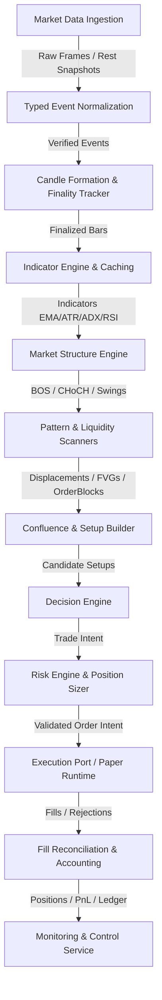

# QuantEngine Phase 162 Architecture and Production-Isolation Audit

## Executive Summary
This document provides the canonical architectural map and production-isolation audit for QuantEngine Phase 162. It audits the end-to-end data and execution graph from market data ingestion through monitoring and control.

---

## Canonical Trading Call Graph
The authoritative lifecycle executes as an unidirectional, deterministic pipeline:

---

## Stage-by-Stage Architecture Audit

### 1. Market Data Ingestion & Normalization
- **Canonical Modules**: `core/bars/candle.py`, `core/bars/bar_series.py`, `core/events/`, `core/exchanges/delta/`
- **Input Contract**: Raw JSON frames from WebSocket stream or REST API endpoints.
- **Output Contract**: Immutable, typed events (`CandleEvent`, `TradeEvent`, `L2SnapshotEvent`). Timestamps normalized to epoch milliseconds; prices and sizes validated as positive finite floats.
- **State Ownership**: Owned by data adapters and feed handlers. Zero state bleed into decision or risk engines.
- **Failure Modes**: Disconnects, malformed JSON, out-of-order sequence IDs. Handled via fail-closed validation, automatic reconnect, and sequence gap recovery.

### 2. Candle Finality & Market Structure
- **Canonical Modules**: `core/pipeline/institutional_pipeline.py`, `core/market_structure/`, `core/trend/`, `core/displacement/`, `core/fvg/`, `core/order_blocks/`, `core/liquidity/`
- **Input Contract**: Finalized candles (`is_final=True`). Forming candles are strictly rejected from structure updates to prevent lookahead bias.
- **Output Contract**: Updated `PipelineContext` carrying detected market swings, structural breaks (BOS/CHoCH), displacement vectors, fair value gaps, order blocks, breakers, and mitigations.
- **Determinism**: 100% deterministic sliding-window computations without random number generators or system-clock dependencies.

### 3. Confluence, Setup, and Decision
- **Canonical Modules**: `core/confluence/`, `core/setup/trade_setup_builder.py`, `core/setup/decision_engine.py`
- **Input Contract**: Current `PipelineContext` with indicators and structural features.
- **Output Contract**: Bounded quality setup score and candidate `TradeSetup` (direction, stop loss, entry zone, take profit targets, risk-reward ratio).
- **Decision Contract**: Strict rejection reasons recorded. Setup must exceed threshold score and satisfy directional trend alignment.

### 4. Risk, Sizing, and Policy
- **Canonical Modules**: `core/risk/risk_engine.py`, `core/risk/position_sizer.py`, `core/risk/trading_policy.py`, `core/risk/conservative_gates.py`
- **Input Contract**: `TradeSetup` and current `AccountState` / `PortfolioState`.
- **Output Contract**: `OrderIntent` with precise integer lot sizing, verified post-cost risk-reward (minimum 1R, maximum 20R), and explicit stop/target levels.
- **Safety Boundary**: Fails closed on any unknown symbol, missing cost metadata, excessive portfolio exposure, or stale market feed. No hidden 6R floor.

### 5. Execution and Paper Runtime
- **Canonical Modules**: `core/runtime/paper_runtime.py`, `core/runtime/verified_runtime.py`, `core/execution/execution_engine.py`
- **Input Contract**: Validated `OrderIntent`.
- **Output Contract**: Executed order states, bracket orders (entry, stop loss, take profit), and simulated/testnet fills.
- **Isolation**: Live order execution is permanently disabled by safe defaults (`is_live=False`).

### 6. Fill Reconciliation and Accounting
- **Canonical Modules**: `core/backtesting/accounting.py`, `core/backtesting/ledger.py`, `core/runtime/reconciliation.py`
- **Input Contract**: Order execution reports, fill messages, funding debit/credit records, and wallet balances.
- **Output Contract**: Realized/unrealized PnL, cash balance, margin requirements, fee tracking, funding debits, and append-only trade ledger.
- **Reconciliation Protocol**: Strict windowed fill matching (`reconcile_with_rest_windowed`), classifying in-window fills, pre-window fills, and unacknowledged trades.

### 7. Monitoring, Control, and API
- **Canonical Modules**: `core/monitoring/api_server.py`, `core/monitoring/service.py`, `core/remote/service.py`
- **Input Contract**: Authenticated HTTP/WebSocket control commands guarded by bearer tokens (constant-time comparison).
- **Output Contract**: Non-secret status snapshots, health metrics, position views, and server-side validated policy updates.
- **Hard Allowlist**: Restricted verbs (`start`, `stop`, `restart`, `emergency_stop`, `pause`, `resume`). Zero direct order entry endpoints from the API surface.

---

## Research and Machine Learning Isolation
- **Isolation Boundary**: All ML research artifacts (`research/`, `research/phase11f/`, etc.) are isolated from the runtime engine.
- **No Direct Imports**: `core/` and `data/` runtime modules contain exactly ZERO imports from `research/` or `_archive/`.
- **Advisory Role Only**: Any future ML model or score acts strictly as an advisory feature within the feature extraction stage and cannot bypass risk or execution gates.

---

## Conclusion
The QuantEngine architecture maintains clean separation of concerns, fail-closed boundaries, unidirectional data flow, and complete research/runtime isolation.
