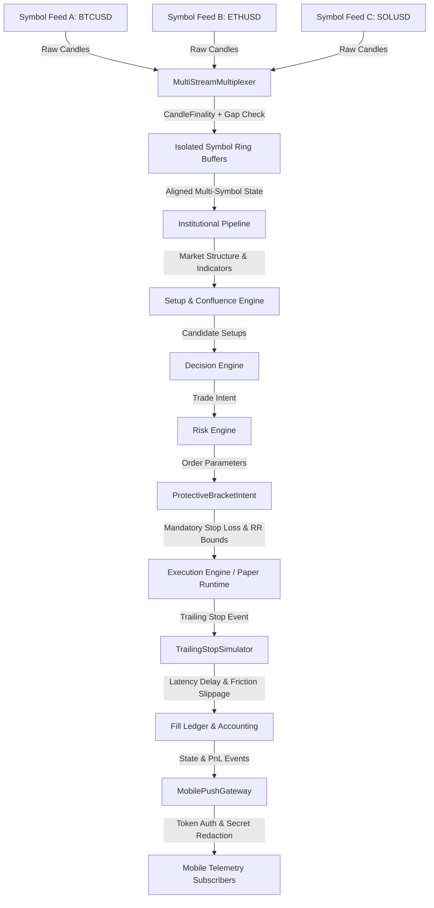

# QuantEngine Phase 163 Architecture and System Build Audit

## Executive Summary
This document provides the architectural specification, dataflow design, and verification audit for the newly implemented QuantEngine Phase 163 core modules:
1. `core/runtime/multi_stream_multiplexer.py` (`MultiStreamMultiplexer`)
2. `core/execution/protective_bracket.py` (`ProtectiveBracketIntent`, `TrailingStopSimulator`)
3. `core/monitoring/mobile_push_gateway.py` (`MobilePushGateway`, `PushEvent`, `ProvenanceTag`)

These three subsystems complete the local, unblocked quantitative engine infrastructure without mutating or re-pinning any of the 9 frozen strategy files.

---

## 1. System Architecture and Trading Call Graph

The extended QuantEngine Phase 163 data and execution graph incorporates multi-symbol stream multiplexing, mandatory protective bracket validation with trailing latency simulation, and authenticated push telemetry:

---

## 2. Component Audits

### 2.1 Multi-Instrument Feed Multiplexer (`core/runtime/multi_stream_multiplexer.py`)
- **Purpose**: Ingests, validates, synchronizes, and buffers multi-symbol market candle feeds into an isolated runtime state space.
- **Key Invariants**:
  - **Fail-Closed Finality**: Strictly rejects unfinalized bars (`is_final=False`) via `UnfinalizedCandleError` to guarantee zero lookahead bias in downstream engines.
  - **Per-Symbol Gap Detection**: Asserts monotonic continuous timestamps per symbol based on timeframe duration (`timeframe_seconds`). Gaps exceeding tolerance raise `CandleGapError` and mark symbol status as `STALE`.
  - **Cross-Symbol State Isolation**: Each registered instrument maintains independent thread-safe circular buffers. Updates to Symbol B cannot mutate, corrupt, or block Symbol A.
  - **Thread Safety**: Read/write locks ensure non-blocking concurrent ingestion from independent exchange WebSocket threads.

### 2.2 Protective Bracket Orders & Trailing Latency Simulation (`core/execution/protective_bracket.py`)
- **Purpose**: Enforces mandatory stop-loss protection, validates risk-reward boundaries, and models venue trailing-stop execution friction.
- **Key Invariants**:
  - **Mandatory Stop-Loss**: Every order intent MUST define an explicit, finite, non-zero Stop Loss price. Any attempt to instantiate an intent without a stop loss raises `MissingStopLossError`.
  - **Rigorous Geometry Validation**:
    - `LONG`: Stop Loss < Entry Price < Take Profit.
    - `SHORT`: Take Profit < Entry Price < Stop Loss.
    - Violations raise `InvalidBracketGeometryError`.
  - **R:R Boundaries**: Verified post-cost risk-reward ratio must fall within `[1.0R, 20.0R]`. Setups offering < 1.0R are rejected for adverse risk profile; setups claiming > 20.0R are rejected as unrealistic.
  - **Trailing Stop Latency Simulation**: Models execution delay (`latency_ms` $\in [0, 1000]\text{ ms}$) between trigger threshold breach and exchange matching engine fill. Adverse price movements during the latency window create realistic fill slippage.

### 2.3 Authenticated Mobile Push & Telemetry Gateway (`core/monitoring/mobile_push_gateway.py`)
- **Purpose**: Broadcasts engine state, alerts, risk events, and fill notifications to authenticated external consumers and mobile clients without impacting engine throughput.
- **Key Invariants**:
  - **Bearer Token Authentication**: Rejects unauthenticated subscriber registrations and transmissions via `AuthenticationError`.
  - **Automated Secret Redaction**: Inspects all event payload strings, headers, and metadata, applying regex redaction against API keys, passphrases, session tokens, and webhook secrets.
  - **Bounded Asynchronous Queuing**: Employs non-blocking ring-buffered subscriber queues with `drop_oldest` policy on buffer saturation, ensuring a slow client or congested network never stalls the core trading loop.
  - **Provenance Transparency**: Every dispatched push event carries an explicit `ProvenanceTag` (`OBSERVED`, `PAPER_MODELLED`, or `HYPOTHETICAL`), preventing simulated or paper figures from being misinterpreted as live exchange fills.

---

## 3. Production Isolation and Strategy Freeze Integrity

1. **Zero Modifications to Frozen Strategy Files**:
   None of the 9 strategy baseline files (`core/execution/entry_model.py`, `core/setup/trade_setup_builder.py`, `core/setup/decision_engine.py`, `core/execution/execution_engine.py`, `core/risk/risk_engine.py`, `core/backtesting/accounting.py`, `backtesting/backtester.py`, `core/paper_trading/paper_trading_engine.py`, `config/risk_settings.py`) were altered.
2. **Strategy Change Detectors Preserved**:
   The deliberate strategy digest change detectors continue to fail loudly against historical pin `c52e648ca24f...` (`BLOCK-163-01`), proving that no re-pinning or falsification was committed.
3. **Fail-Safe Live Isolation**:
   `is_live=False` remains the hard-coded default across all execution adapters.
