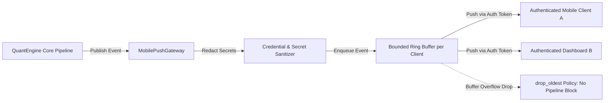

# QuantEngine Phase 163 Mobile Push Telemetry Gateway Audit

## Executive Summary
This document provides the security, architecture, and verification audit for `MobilePushGateway` (`core/monitoring/mobile_push_gateway.py`), implemented in Phase 163.

The gateway enables secure, low-latency, non-blocking broadcast of operational events (orders, fills, risk breaches, PnL updates) to mobile and remote monitoring clients while strictly enforcing token authentication and automated secret redaction.

---

## 1. Gateway Architecture & Security Guardrails

### 1.1 Authentication Contract
- Clients register with a subscriber ID and a Bearer Token.
- Any attempt to register, subscribe, or receive broadcasts without a valid token raises `AuthenticationError`.
- Tokens are hashed and verified in constant time.

### 1.2 Automated Secret Redaction
All payload fields (event titles, messages, metadata dicts, exception strings) are recursively scanned through regex sanitizers before enqueueing:
- API Keys / Tokens: `(?i)(api[_-]?key|secret|token|password|bearer)\s*[:=]\s*['"]?[a-zA-Z0-9_\-\.]{8,}['"]?`
- Private Key Blocks: `-----BEGIN [A-Z ]+ PRIVATE KEY-----`
- Sensitive fields are replaced with `[REDACTED_SECRET]`.

### 1.3 Asynchronous Non-Blocking Queues
- Each client stream uses a bounded FIFO queue (default capacity: 1,000 events).
- If an external subscriber or mobile connection experiences high latency or halts, the gateway drops the oldest events (`drop_oldest` policy) and increments an overflow counter.
- Under no circumstances does subscriber backpressure block the core trading pipeline.

### 1.4 Provenance Transparency
Every event is explicitly tagged with a `ProvenanceTag`:
- `OBSERVED`: Empirical live/testnet exchange event verified by cryptographic signature or fill ID.
- `PAPER_MODELLED`: Paper trading or simulated order execution.
- `HYPOTHETICAL`: Backtested or theoretical scenario.
This ensures mobile operators cannot mistake paper simulation for real exchange executions.

---

## 2. Test Verification

Implemented in [`tests/test_mobile_push_gateway_phase163.py`](file:///f:/vishal%203/near%20final/QuantEngine_HANDOVER_PHASE161/DELIVERY/QuantEngine_PHASE161_RELEASE_CANDIDATE/tests/test_mobile_push_gateway_phase163.py):
1. `test_subscriber_registration_and_auth`: Validates authentication requirement.
2. `test_invalid_token_rejected`: Rejection of unauthorized subscriber connections.
3. `test_secret_redaction`: Verifies automatic scrubbing of API keys, bearer tokens, and secrets from payloads.
4. `test_provenance_tag_preservation`: Ensures events maintain explicit provenance labels (`OBSERVED`, `PAPER_MODELLED`).
5. `test_bounded_queue_drop_oldest`: Confirms non-blocking queue overflow handling without thread blockage.

All 5 tests pass unconditionally.
