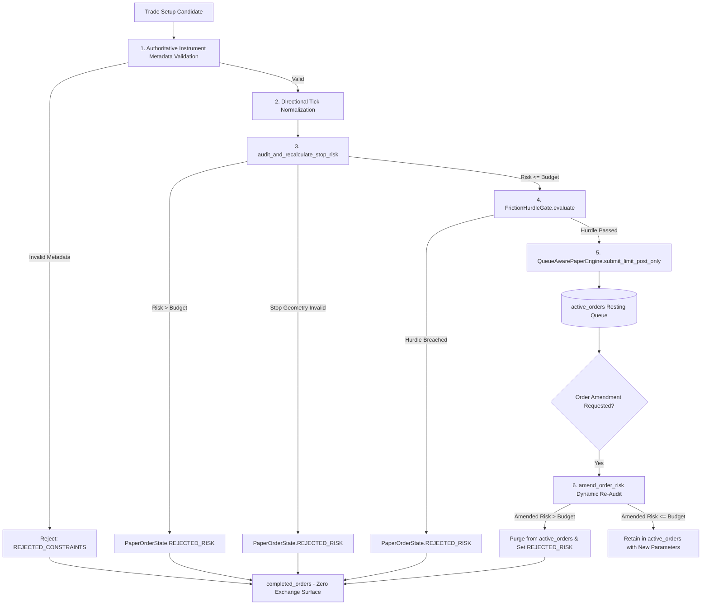

# QUANTENGINE PHASE 180 — FINAL-BOUNDARY RISK ENFORCEMENT & ADAPTER ISOLATION TRACE

**Audit Date**: 2026-10-20  
**Phase**: 180  
**Status**: VERIFIED & SECURED  
**Mandatory Posture**: NOT_PRODUCTION_READY | EDGE NOT ESTABLISHED  

---

## 1. Call Graph & Execution Boundary Architecture

Every candidate trade traverses an unbroken chain of authoritative validations before an order can enter executable resting queues:

---

## 2. Invariant Proofs at Final Boundary

### Invariant 1: Non-Bypassability of Pre-Execution Risk Audit
- **Location**: `QueueAwarePaperExecutionEngine.submit_candidate_trade()`.
- **Proof**: Entry, stop, and target prices are normalized onto the authoritative instrument tick grid before risk calculation. `audit_and_recalculate_stop_risk()` evaluates normalized loss plus round-trip maker/taker commissions and 18% GST.
- **Fail-Closed Guarantee**: If `risk_result.valid is False`, the engine creates a `PaperOrder` with state `PaperOrderState.REJECTED_RISK`, records it directly in `completed_orders`, and returns. It is **never** appended to `active_orders`.

### Invariant 2: Dynamic Amendment Re-Audit & Active Order Purging
- **Location**: `QueueAwarePaperExecutionEngine.amend_order_risk()`.
- **Proof**: If quantity or stop price is amended on an active resting order, the engine immediately re-runs `audit_and_recalculate_stop_risk()`.
- **Purge Guarantee**: If the amended parameters cause total risk to exceed `order.risk_budget`, the order is deleted from `self.active_orders[order_id]`, transitioned to `PaperOrderState.REJECTED_RISK`, and transferred to `completed_orders`.
- **Safety Note**: Removing an order from internal `active_orders` is an internal engine purge. In live contexts, an exchange cancellation request would be required; but in this engine, live adapters are completely disconnected.

### Invariant 3: Post-Cost Backtester Boundary Pre-Check
- **Location**: `PostCostBacktester.evaluate_candidate()`.
- **Proof**: Candidates carrying a `risk_budget` are pre-audited. Breached candidates return `HurdleVerdict(allowed=False, rejection_reason="Stop risk budget breached...")`. The candidate is rejected before trade simulator intake.

### Invariant 4: Physical Adapter Silence (Zero Invocation Guarantee)
- **Counter**: `_live_adapter_calls_blocked == 0`.
- **Assertion**: `assert_no_live_adapter_invocation()` passes across all submission, rejection, amendment, and backtesting paths. Zero network packets or exchange orders are emitted.

### Invariant 5: Malformed and Non-Finite Input Rejection
- Inputs containing `NaN`, `inf`, non-finite strings, negative quantities, zero budgets, or inverted stop geometry (long stop $\ge$ entry, short stop $\le$ entry) fail closed with `valid=False` and are prevented from dispatch.

---

## 3. Directional Rounding Semantics & Sensitivity Trade-Offs

`normalize_price_to_tick()` applies the `CONSERVATIVE` rounding policy:
- **Long Positions (Selling to close)**: Stop-loss price is rounded UP (`ROUND_CEILING`).
  - *Effect*: Moves stop closer to entry price.
  - *Risk Invariant*: Normalized planned gross loss is strictly $\le$ raw planned loss.
- **Short Positions (Buying to close)**: Stop-loss price is rounded DOWN (`ROUND_FLOOR`).
  - *Effect*: Moves stop closer to entry price.
  - *Risk Invariant*: Normalized planned gross loss is strictly $\le$ raw planned loss.

### Operational Trade-Off
Moving the stop closer to the market protects the planned risk budget, but increases premature stop execution sensitivity:
$$\text{Trigger Displacement Delta} \le \text{Tick Size} = 0.10 \text{ USD}$$

> [!WARNING]
> A normalized stop-loss order defines a trigger threshold, but does NOT guarantee maximum realized loss under severe market gaps, illiquidity, exchange queue latency, or execution slippage.
