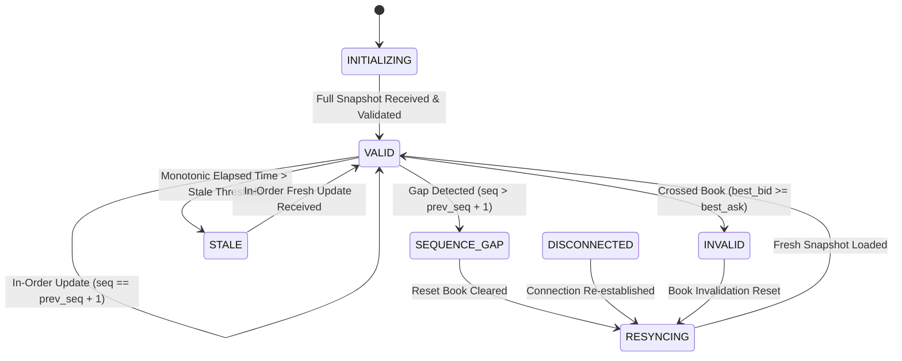

# QuantEngine Phase 187: Continuous L2 Market-Data Evidence Protocol

**Protocol Version**: `1.0.0-phase187`  
**Date**: `2026-10-21`  
**Operating Posture**: `NOT_PRODUCTION_READY` | `EDGE NOT ESTABLISHED` | Release Gate: `HOLD`  
**Execution Authority**: Read-Only Market Data Capture (`writes_to_exchange = 0`)  

---

## 1. Scope and Objective

This protocol defines the production-grade, read-only Level 2 (L2) market-data capture, sequencing, validation, and storage pipeline for QuantEngine Phase 187. 

The objective is to establish an immutable, verifiable, and falsifiable stream of order-book events across the target symbol universe (`BTCUSD`, `ETHUSD`, `SOLUSD`) on Delta Exchange Testnet, establishing continuous evidence of market microstructure, latency, spread, and queue dynamics without risking any exchange writes or synthetic order submissions.

---

## 2. Venue and Network Endpoints

| Parameter | Specification | Authority / Verification |
| :--- | :--- | :--- |
| **Exchange Venue** | Delta Exchange (India Testnet) | `research.economics.delta_environment` |
| **Environment Mode** | `SANDBOX / TESTNET` | Strict fail-closed isolation |
| **Public WebSocket** | `wss://socket-ind-pub.testnet.deltaex.org` | Unauthenticated, read-only |
| **Public REST Endpoint** | `https://cdn-ind.testnet.deltaex.org` | Read-only market data / products |
| **Order Placement Capability** | **DISABLED / ZERO** | No trading routes in capture pipeline |
| **Credentials Used** | **NONE** (Public feeds require zero API keys) | Zero credential leakage risk |

---

## 3. Target Symbol Universe & Contract Specifications

Target contracts are referenced against authoritative metadata snapshots (`research/results/phase185_testnet_products_snapshot.json`):

| Symbol | Product ID | Contract Multiplier | Tick Size | Minimum Order Size | Step Size |
| :--- | :---: | :---: | :---: | :---: | :---: |
| **BTCUSD** | `84` | `0.001` | `$0.10` | `1` | `1` |
| **ETHUSD** | `132` | `0.01` | `$0.01` | `1` | `1` |
| **SOLUSD** | `295` | `0.1` | `$0.01` | `1` | `1` |

---

## 4. Ingestion Wire Protocol & Channels

### 4.1 Subscription Payload
Public channels are subscribed via JSON frames over `wss://socket-ind-pub.testnet.deltaex.org`:
```json
{
  "type": "subscribe",
  "payload": {
    "channels": [
      {"name": "ob_updates", "symbols": ["BTCUSD", "ETHUSD", "SOLUSD"]},
      {"name": "all_trades", "symbols": ["BTCUSD", "ETHUSD", "SOLUSD"]}
    ]
  }
}
```

### 4.2 Raw Ingestion Message Schema
Incoming orderbook frames (`type: ob_updates`) carry the following canonical structure:
- `sy`: Symbol identifier (`BTCUSD`, `ETHUSD`, `SOLUSD`).
- `seq`: Monotonically increasing sequence integer per symbol.
- `cs`: Checksum integer computed by exchange engine over top book levels.
- `ts`: Exchange event timestamp in integer microseconds (`us`).
- `action`: `"snapshot"` (full reset) or `"update"` (incremental delta).
- `b`: List of bid price/quantity pairs `[[price_str, size_str], ...]`. A size of `"0"` denotes level deletion.
- `a`: List of ask price/quantity pairs `[[price_str, size_str], ...]`. A size of `"0"` denotes level deletion.

---

## 5. Seven-State Order-Book Validity State Machine

To prevent invalid, stale, or corrupt market states from poisoning quantitative evaluation or execution simulation, every symbol's book is managed by `core.research.l2_book_tracker.L2BookTracker` implementing a strict 7-state finite state machine:



### State Definitions & Transition Criteria

1. **`INITIALIZING`**: Initial starting state. Book is empty. No analytical metrics or simulated order fills may occur.
2. **`VALID`**: Monotonic sequence verified ($seq = seq_{prev} + 1$), strictly non-crossed ($best\_bid < best\_ask$), non-negative price/size, and timestamp is fresh.
3. **`STALE`**: Monotonic elapsed time since last received message exceeds `stale_threshold_seconds` (default: 5.0s). The book cannot be relied upon for active pricing.
4. **`SEQUENCE_GAP`**: A gap is detected ($seq > seq_{prev} + 1$). An immutable `L2GapRecord` is emitted. The book is immediately invalidated. No updates may be applied until resynchronization.
5. **`DISCONNECTED`**: Transport WebSocket connection dropped or timed out. All symbol books are transitioned to `RESYNCING`.
6. **`RESYNCING`**: The existing book memory is purged (`bids.clear()`, `asks.clear()`). Awaiting a complete snapshot from the exchange.
7. **`INVALID`**: An unrecoverable integrity violation occurred (e.g. $best\_bid \ge best\_ask$, or negative price). Book is rejected and must resync.

---

## 6. Timestamp Taxonomy and Latency Measurement

To eliminate clock ambiguity, three distinct temporal coordinates are captured for every event:

1. **Exchange Venue Event Time ($t_{venue}$)**:
   - Units: Microseconds (`us`) since Unix epoch.
   - Origin: Delta Exchange matching engine clock.
2. **Local Receipt Monotonic Time ($t_{receipt, mono}$)**:
   - Units: Nanoseconds (`ns`) from `time.monotonic_ns()`.
   - Origin: Local operating system high-resolution monotonic timer.
   - Guarantee: Immune to system clock adjustments, NTP steps, or leap seconds. Used for timeout and staleness evaluation.
3. **Local Receipt Wall-Clock Time ($t_{receipt, UTC}$)**:
   - Units: Nanoseconds (`ns`) from `time.time_ns()`.
   - Origin: Local UTC clock.
4. **Transit / Receive Latency Measurement**:
   $$\text{Latency (ms)} = \frac{t_{receipt, UTC} - (t_{venue} \times 1000)}{1,000,000}$$
   *Note: This metric represents local receive latency including network transit, kernel buffer delay, and venue clock offset. It is preserved without manual adjustments.*

---

## 7. Storage, Provenance & Immutability

1. **Raw Captures (`.jsonl`)**:
   - Every raw frame is appended as a single-line JSON string containing `receipt_mono_ns`, `receipt_utc_ns`, and `raw`.
   - Upon session completion or interrupt, the file is closed and hashed with SHA-256.
   - The detached SHA-256 digest is permanently recorded in the quality summary.
2. **Quality Summaries (`.json`)**:
   - Contains message counts, coverage percentages, sequence gap incident logs, and spread/depth distributions.
   - Retained under `research/captures/phase187_l2/`.
3. **Release Isolation**:
   - Raw capture files are research evidence and remain access-controlled. They are never bundled into release archives unless explicitly registered in `BUILD_MANIFEST.sha256`.

---

## 8. Incident Response & Gap Handling

- Gaps are never silently interpolated or patched by copying previous levels.
- A gap incident increments `gap_count`, triggers `L2GapRecord` logging, and marks the book `SEQUENCE_GAP`.
- Resynchronization requires clearing book state and receiving a new snapshot from Delta Exchange.
