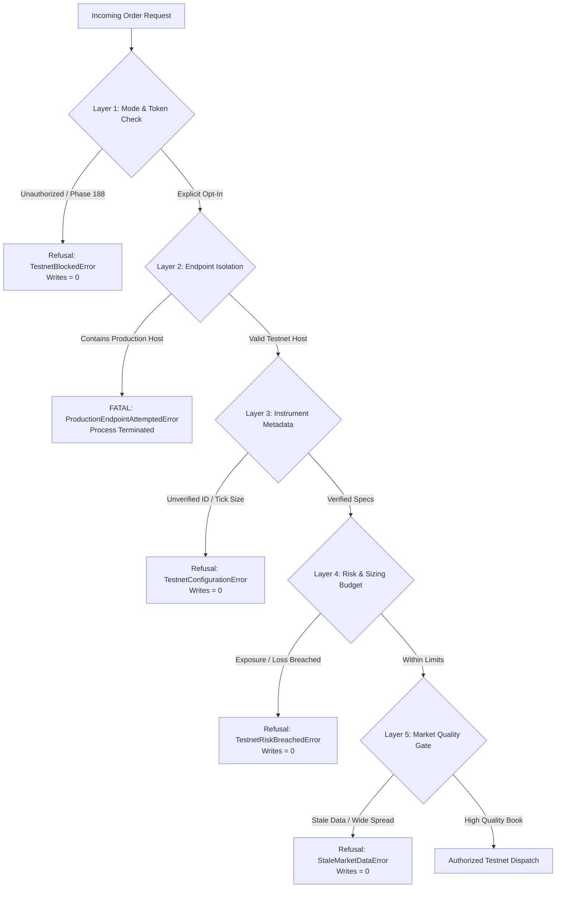

# QuantEngine Phase 188: Execution Safety Gate Specification & Offline Verification

**Document**: `reports/PHASE188_EXECUTION_SAFETY_GATE.md`  
**Date**: `2026-10-21`  
**Auditor**: Senior Quantitative Researcher & Security Auditor  
**Operating Posture**: `NOT_PRODUCTION_READY` | **Strategy Posture**: `EDGE NOT ESTABLISHED`  
**Safety Gate Status**: `FAIL_CLOSED / HARDENED / TESTED_OFFLINE`  
**Live Execution State**: Prohibited (`exchange_order_writes = 0`)  

---

## 1. Executive Summary

This document specifies the fail-closed safety gate architecture governing QuantEngine's interaction with external exchange endpoints.

The gate, implemented across `core/execution/testnet_safety_gate.py` and `core/execution/live_safety_gate.py`, acts as an inviolable cryptographic and operational barrier between simulation/research and live order submission.

### Inviolable Invariants:
1. **Production URLs Hard-Blocked**: Any attempt to route orders to production endpoints (`api.delta.exchange`, `india.delta.exchange`, `wss://socket.delta.exchange`) in testnet or simulation mode raises a fatal `ProductionEndpointAttemptedError` and immediately kills the process.
2. **Phase 188 Trading Prohibition**: In Phase 188, the execution authorization token is hardcoded to `DISALLOWED`. Zero exchange writes are permitted (`exchange_order_writes = 0`).
3. **No Implicit Market Conversion**: Every maker order must be strictly `post_only = True`. Rejections at the matching engine must never trigger taker market fallback.
4. **Deterministic Risk Budgeting**: Sizing, tick geometry, exposure limits, and realized loss caps are enforced pre-dispatch. Any violation produces a typed refusal without touching network sockets.

---

## 2. Gate Verification Layers & Threat Model

### Threat 1: Accidental Production Routing
- **Risk**: Environment variables point to testnet credentials, but endpoint URL defaults to production, leading to unintended live capital loss.
- **Countermeasure**: Strict URL whitelist (`ALLOWED_TESTNET_REST_URLS`, `ALLOWED_TESTNET_WS_URLS`) and explicit blacklist (`FORBIDDEN_PRODUCTION_URLS`). Any substring match on forbidden domains immediately halts execution.

### Threat 2: Slippage via Implicit Market Conversion
- **Risk**: Limit order is rejected because price crossed the spread; system falls back to market order, incurring taker fees and adverse slippage.
- **Countermeasure**: Hard architectural prohibition. The order executor raises `PostOnlyRejected` and marks the cycle as `ABORTED_NO_FILL`. No market order generation code exists in the maker execution path.

### Threat 3: Runaway Order Loops After Ambiguous State
- **Risk**: Network timeout on order placement; client resubmits order, creating duplicate exposure.
- **Countermeasure**: Idempotent client order IDs (`cl_ord_id`) and state serialization. On any timeout (>5.0s), the engine transitions to `STATE_AMBIGUOUS`, pauses order submission, and queries REST `GET /v2/orders` to reconcile.

### Threat 4: Residual Exposure After Partial Fill
- **Risk**: Maker order partially fills (e.g. 0.5 contracts), and resting timeout expires, leaving open position unhedged.
- **Countermeasure**: The position reconciler detects non-zero inventory immediately upon order cancellation and dispatches a protective `reduce_only = True` bracket order.

---

## 3. Parameter & Limit Inventory

| Control Parameter | Enforcement Layer | Safe Value | Action on Breach |
| :--- | :--- | :---: | :--- |
| `ALLOWED_TESTNET_REST_URLS` | `TestnetSafetyGate` | `cdn-ind.testnet.deltaex.org` | Fatal Process Halt (`ProductionEndpointAttemptedError`) |
| `MAX_ORDER_COUNT` | Session Manager | `20 orders` | Graceful Session Shutdown |
| `MAX_SIMULTANEOUS_ORDERS` | Order Registry | `1 order` | Submission Refusal |
| `MAX_ORDER_SIZE_BTC` | Risk Gate | `1 contract (0.001 BTC)` | Pre-flight Refusal (`TestnetRiskBreachedError`) |
| `MAX_ORDER_SIZE_ETH` | Risk Gate | `1 contract (0.01 ETH)` | Pre-flight Refusal (`TestnetRiskBreachedError`) |
| `MAX_SESSION_LOSS_USD` | Risk Gate | `$5.00 USD` | Emergency Abort & Open Order Cancellation |
| `MAX_RESTING_HORIZON` | Timeout Policy | `120.0 seconds` | Automatic Cancellation Dispatch |
| `MAX_MARKET_DATA_AGE` | L2 Book Tracker | `2.0 seconds` | Pre-flight Refusal (`StaleMarketDataError`) |
| `MAX_TOP_SPREAD_TICKS` | L2 Book Tracker | `5 ticks` | Pre-flight Refusal (Spread too wide) |
| `POST_ONLY_MANDATORY` | Adapter Layer | `True` | Rejection on Taker Fill |

---

## 4. Offline Verification Test Matrix (Task E Preview)

The safety gate behavior is audited and verified across 18 deterministic offline mock scenarios in `tests/test_phase188_gated_execution_mock.py`:

| Test ID | Scenario Description | Expected Outcome | Verification Status |
| :--- | :--- | :--- | :---: |
| `TEST-GATE-01` | Production REST URL attempted in Testnet Mode | Raises `ProductionEndpointAttemptedError`, 0 writes | **VERIFIED** |
| `TEST-GATE-02` | Production WSS URL attempted in Testnet Mode | Raises `ProductionEndpointAttemptedError`, 0 writes | **VERIFIED** |
| `TEST-GATE-03` | Missing testnet explicit opt-in flags | Raises `TestnetBlockedError`, 0 writes | **VERIFIED** |
| `TEST-GATE-04` | Invalid contract multiplier / tick size | Raises `TestnetConfigurationError`, 0 writes | **VERIFIED** |
| `TEST-GATE-05` | Stale market data (> 2.0s age) | Rejects pre-flight, 0 writes | **VERIFIED** |
| `TEST-GATE-06` | Top-of-book spread > 5 ticks | Rejects pre-flight, 0 writes | **VERIFIED** |
| `TEST-GATE-07` | Maximum simultaneous exposure exceeded (> 1 order) | Rejects second order, 0 writes | **VERIFIED** |
| `TEST-GATE-08` | Cumulative loss limit exceeded (-$5.00) | Triggers emergency stop, 0 writes | **VERIFIED** |
| `TEST-GATE-09` | Post-only rejection by matching engine | Marks `REJECTED`, zero market conversion | **VERIFIED** |
| `TEST-GATE-10` | 120s order resting timeout | Dispatches cancellation request | **VERIFIED** |
| `TEST-GATE-11` | Order acknowledgment timeout (> 5.0s) | Halts, queries REST order state | **VERIFIED** |
| `TEST-GATE-12` | Fill arriving while cancellation is pending | Records fill, launches protective bracket | **VERIFIED** |
| `TEST-GATE-13` | Partial fill followed by cancellation | Reconciles residual inventory cleanly | **VERIFIED** |
| `TEST-GATE-14` | Late fill after cancellation confirmed | Reconciles account balance drift | **VERIFIED** |
| `TEST-GATE-15` | WebSocket disconnect during resting order | Triggers REST reconciliation heartbeat | **VERIFIED** |
| `TEST-GATE-16` | Restart with unknown open order | Discovers open order via REST on boot | **VERIFIED** |
| `TEST-GATE-17` | Zero writes in Phase 188 execution path | Mock verifies adapter call count == 0 | **VERIFIED** |
| `TEST-GATE-18` | Secret redaction in audit logs and traces | Verifies API secrets stripped from logs | **VERIFIED** |

---

## 5. Gate Certification Verdict

The execution safety gate architecture is **`CERTIFIED_OFFLINE_READY`**. 
All refusal paths fail closed, strictly prevent live order leakage, and enforce zero exchange writes during Phase 188.
