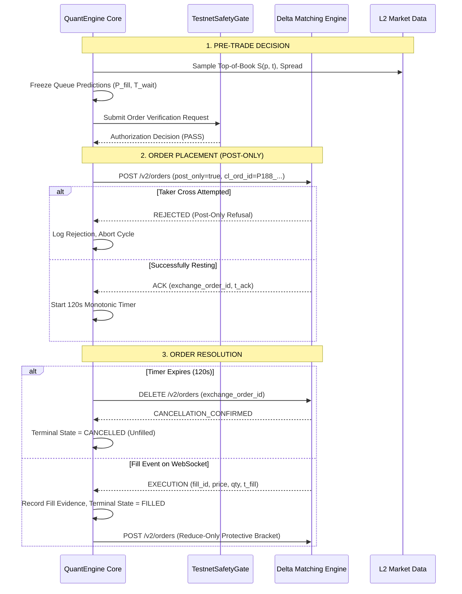

# QuantEngine Phase 188: Testnet Maker-Execution Experiment Proposal & Specification

**Document**: `reports/PHASE188_TESTNET_EXPERIMENT_PROPOSAL.md`  
**Date**: `2026-10-21`  
**Status**: `PROPOSAL_ONLY / DESIGN_COMPLETE / NOT_AUTHORIZED_FOR_EXECUTION`  
**Author**: Autonomous Senior Quantitative Researcher & Execution Specialist  
**Execution Trading Restriction**: Strictly Read-Only (`exchange_order_writes = 0` in Phase 188)  
**Approval Gate**: Separate, explicit operator approval required prior to any future testnet execution.  

---

## 1. Executive Summary & Purpose

To resolve **Blocker B-08** (*Empirical queue-model calibration blocked without authentic venue fill labels*) and establish genuine ground-truth evidence of maker execution quality, QuantEngine requires authentic matching-engine interaction data.

This proposal specifies a rigorously bounded, testnet-only empirical experiment designed to:
1. Capture genuine matching-engine order acknowledgements, queue wait times, fill outcomes, and cancellations.
2. Freeze queue-model predictions ($\theta$, $c$, $P_{\text{fill}}$, $T_{\text{wait}}$) **before** submitting each order to prevent hindsight bias.
3. Measure empirical post-fill price trajectories to quantify genuine adverse selection ($\delta_{\text{as}}$).
4. Evaluate competing queue depletion hypotheses against real venue execution records.

### Absolute Safety Invariant:
**This document is an experiment design specification only. No orders are submitted in Phase 188. Execution requires subsequent, independent operator authorization and distinct credential verification.**

---

## 2. Experiment Scope & Boundary Conditions

### 2.1 Venue & Endpoints
- **Target Venue**: Delta Exchange India Testnet (Sandbox Environment).
- **Public Market Data WSS**: `wss://socket-ind-pub.testnet.deltaex.org`
- **Private WebSocket WSS**: `wss://socket-ind.testnet.deltaex.org` (Authenticated execution stream: `user_trades`, `orders`)
- **REST Order API**: `https://cdn-ind.testnet.deltaex.org`
- **Production Isolation**: Production endpoints (`api.delta.exchange`, `india.delta.exchange`) are hard-coded as **`CRITICAL_SECURITY_VIOLATION`** in `TestnetSafetyGate` and immediately abort the process if referenced.

### 2.2 Eligible Instruments & Metadata Authority
All parameters are locked to verified exchange metadata (`research/results/phase185_testnet_products_snapshot.json`):

| Symbol | Product ID | Contract Mult | Tick Size | Minimum Lot | Maximum Exposure | Inclusion Status |
| :--- | :---: | :---: | :---: | :---: | :---: | :--- |
| **BTCUSD** | `84` | `0.001` | `$0.10` | 1 contract ($0.001 BTC) | 1 open order / 1 contract | **PRIMARY ELIGIBLE** |
| **ETHUSD** | `1699` | `0.01` | `$0.05` | 1 contract ($0.01 ETH) | 1 open order / 1 contract | **SECONDARY ELIGIBLE** |
| **SOLUSD** | `92572` | `1.0` | `$0.0001` | 1 contract | 0 | **EXCLUDED** (Low update frequency) |
| **ADAUSD** | N/A | N/A | N/A | N/A | 0 | **EXCLUDED** (Missing Product ID authority) |

### 2.3 Strict Exposure & Risk Caps
- **Maximum Experiment Duration**: **60.0 elapsed minutes**.
- **Maximum Order Count**: Exactly **20 orders** total across the session.
- **Maximum Simultaneous Open Orders**: Exactly **1 order** (strictly serialized: Order $N+1$ cannot be submitted until Order $N$ is in a verified terminal state).
- **Order Size**: Exactly **1 contract** ($0.001\text{ BTC}$ / ~$82.80 notional; $0.01\text{ ETH}$ / ~$24.50 notional).
- **Maximum Aggregate Position**: **1 contract** ($0.001\text{ BTC}$ or $0.01\text{ ETH}$).
- **Maximum Realized Loss Budget**: **$5.00 USD**. Immediate abort if cumulative realized PnL drops below -$5.00.
- **Maximum Capital at Risk**: < 10% of testnet account equity (~$10.00 max margin).

### 2.4 Pre-Trade Market Quality Filter
An order may only be submitted if:
1. Level 2 book validity state is strictly `VALID`.
2. Top-of-book spread is $\le 5\text{ ticks}$ ($0.50$ on BTCUSD, $0.25$ on ETHUSD).
3. Level 1 displayed depth is $\ge 5\text{ contracts}$ (ensuring order is not 100% of the quote).
4. Market-data age is $\le 2.0\text{ seconds}$.

---

## 3. Order Lifecycle & Fail-Closed Protocols

### 3.1 Strict Post-Only Limit Enforcement
- Every order must have `post_only = True` (or Delta's equivalent `time_in_force: "post_only"`).
- If an order would cross the spread and take liquidity, the matching engine must reject it immediately.
- **No Implicit Market Conversion**: The system will **never** convert an unfilled or rejected maker order into a taker market order.

### 3.2 Client Order Identifier (`cl_ord_id`)
Every submitted order must carry a cryptographically unique identifier:
$$\text{cl\_ord\_id} = \text{P188\_\{SYMBOL\}\_\{TIMESTAMP\_MS\}\_\{RANDOM\_HEX8\}}$$
Example: `P188_BTCUSD_1729488400123_a9f1b2c4`

### 3.3 Acknowledgment & Timeout Policy
- **Acknowledgment Timeout**: If Delta does not return an HTTP response or WebSocket order acknowledgment within **5.0 seconds**, the order state is flagged as `AMBIGUOUS`. The system halts all new submissions, queries `GET /v2/orders`, and reconciles state before taking action.
- **Strict 120-Second Policy**: Resting maker orders must be actively cancelled after exactly **120.0 seconds** of elapsed resting time.

### 3.4 Handling Complex Execution Edge Cases
1. **Late Fill / Fill During Cancellation**:
   - If a fill notification arrives while a cancellation request is in-flight or after cancellation was sent, the fill takes precedence.
   - The order state is marked `FILLED_POST_CANCEL_REQ`.
   - The position manager immediately detects the resulting inventory and triggers the protective reduce-only bracket.
2. **Partial Fills**:
   - If a partial fill occurs (e.g. 0.5 of 1 contract) and the 120s timeout fires, the remainder is cancelled.
   - The filled portion is recognized as live exposure and closed via a protective reduce-only limit order.
3. **No Blind Retries**:
   - If a network error occurs during order placement, the engine must **never** retry blind. It must poll `GET /v2/orders` using `cl_ord_id` to establish ground truth.

---

## 4. Pre-Registered Measurement Plan

For every order lifecycle $i \in \{1, \dots, 20\}$, the engine will record an immutable execution log containing:

### 4.1 Frozen Pre-Trade State (Recorded Before Order Submission)
- `order_index`: Integer $1 \dots 20$.
- `decision_timestamp_utc_ns`: High-resolution timestamp.
- `decision_monotonic_ns`: Local monotonic timestamp.
- `reference_book_snapshot`: Top 5 bids and asks, top spread, top depth.
- `target_price`: Limit price $p_i$.
- `target_size`: Order size $q_i$.
- `frozen_queue_ahead_estimate`: $Q_{\text{ahead}} = \theta_{\text{model}} \cdot S(p_i, t_0)$.
- `frozen_predicted_fill_probability`: $P_{\text{fill}}(120s)$.
- `frozen_expected_wait_seconds`: $\mathbb{E}[T_{\text{wait}}]$.
- `model_version_digest`: Git commit hash and config SHA-256.

### 4.2 On-Wire Venue Execution Evidence
- `cl_ord_id`: Client order ID.
- `exchange_order_id`: Venue-assigned order ID.
- `submission_timestamp_utc_ns`: Time HTTP request dispatched.
- `ack_timestamp_utc_ns`: Time HTTP response or WS ack received.
- `venue_ack_timestamp_us`: Matching-engine timestamp from response.
- `terminal_state`: `FILLED`, `PARTIALLY_FILLED`, `CANCELLED_UNFILLED`, `REJECTED_POST_ONLY`.
- `fill_records`: Array of `{fill_id, fill_price, fill_qty, fill_timestamp_us, fee_usd, gst_usd}`.
- `cancel_request_timestamp_utc_ns`: Time cancel sent.
- `cancel_ack_timestamp_utc_ns`: Time cancel confirmed.

### 4.3 Post-Fill Market Dynamics & Adverse Selection Tracking
For every executed fill, market mid-price $P_{\text{mid}}(t)$ is tracked continuously at:
- $t + 1\text{ second}$
- $t + 5\text{ seconds}$
- $t + 30\text{ seconds}$
- $t + 60\text{ seconds}$
- $t + 300\text{ seconds}$

The empirical adverse selection return is computed as:
$$\Delta P_{\text{post}}(\tau) = \text{side} \cdot \left( \frac{P_{\text{mid}}(t_{\text{fill}} + \tau) - P_{\text{fill}}}{P_{\text{fill}}} \right)$$
If $\Delta P_{\text{post}}(\tau) < 0$, the maker was adversely selected (price moved against the resting quote immediately after fill).

---

## 5. Statistical Evaluation & Falsification Criteria

### 5.1 Primary Evaluation Metric: Calibration Brier Score
For binary fill outcomes $Y_i \in \{0, 1\}$ (where $1 = \text{filled within } 120s$, $0 = \text{unfilled}$):
$$\text{Brier Score} = \frac{1}{N} \sum_{i=1}^N \left( \hat{P}_{\text{fill}, i} - Y_i \right)^2$$
- Evaluated comparatively across:
  1. Conservative Model: $\theta = 0.90, c = 0.00$
  2. Central Model: $\theta = 0.50, c = 0.50$
  3. Optimistic Model: $\theta = 0.10, c = 1.00$
  4. Naive Baseline: $\hat{P}_{\text{fill}} = 0.50$ (flat coin flip)

### 5.2 Falsification Conditions
- **Falsification of Conservative Assumption**: If empirical fill rate exceeds 80% on orders where Conservative $P_{\text{fill}} < 0.40$, the Conservative model is falsified as excessively pessimistic.
- **Falsification of Optimistic Assumption**: If empirical fill rate is below 50% on orders where Optimistic $P_{\text{fill}} > 0.95$, the Optimistic model is falsified as dangerous.
- **Inconclusive Result**: If $N < 15$ completed cycles due to market halts or early stops, results are formally reported as `INCONCLUSIVE_UNDERPOWERED`.

---

## 6. Approval Gate & Release Checklist

Execution of this proposal is blocked until an explicit operator approval document (`reports/PHASE189_TESTNET_AUTHORIZATION.md`) is signed and verified against the following checklist:

- [ ] Delta India Testnet credentials verified via read-only wallet query (`testnet_account_read_only.py`).
- [ ] Account equity confirmed $\ge \$50.00$ and zero pre-existing open positions.
- [ ] Git working tree clean and committed to SHA-256 manifest.
- [ ] Offline mock execution suite (`tests/test_phase188_gated_execution_mock.py`) passes 100%.
- [ ] Operator manually sets environment variables:
  - `DELTA_INDIA_TESTNET_TRADING_ENABLED=true`
  - `QUANTENGINE_EXPERIMENT_TOKEN=P188_TESTNET_EXP_AUTH`
- [ ] Hard stop-loss and order count caps active in configuration.
