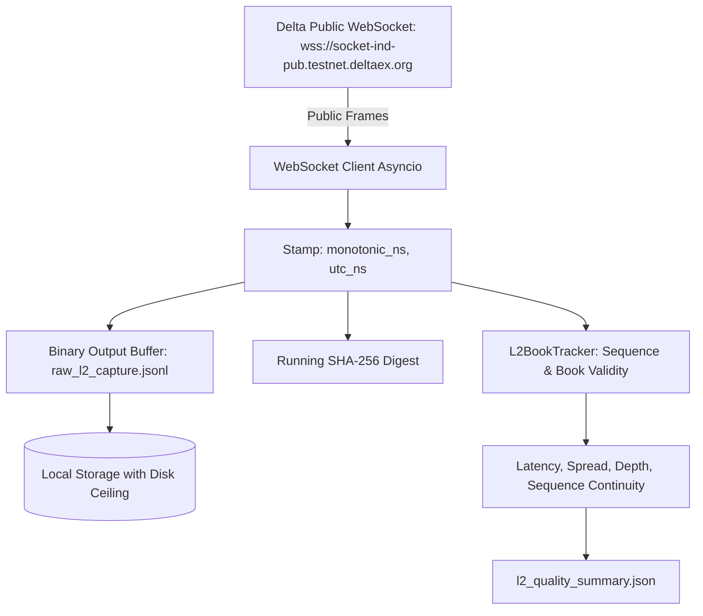

# QuantEngine Phase 189: Continuous Multi-Day Market-Data Capture Readiness Plan

**Document**: `reports/PHASE189_CAPTURE_READINESS_PLAN.md`  
**Date**: `2026-10-21`  
**Author**: Autonomous Senior Market-Data Engineer & Infrastructure Auditor  
**Blocker B-07 Status**: **`PARTIAL`** (Current capture is 180.172s; multi-day continuity remains unobtained)  
**Operating Posture**: `NOT_PRODUCTION_READY` | `EDGE NOT ESTABLISHED`  

---

## 1. Executive Summary & Ground-Truth Context

In Phase 188, `scripts/capture_l2_continuous_pipeline.py` successfully streamed 180.172 continuous seconds of public Level 2 orderbook and trade data across BTCUSD and ETHUSD (`research/captures/phase188_l2/raw_l2_capture_20261021T052549Z.jsonl`, 256,038 bytes on disk).

Per the strict non-negotiable governance principles of QuantEngine:
1. **No Concatenation of Disjoint Intervals**: A multi-day evidence dataset cannot be assembled by stitching together disparate short runs. It must represent an unbroken, continuous temporal record.
2. **Accurate Duration Accounting**: The current 3-minute capture must remain classified as `PARTIAL` evidence. It is never relabeled as a multi-day or 24-hour dataset.
3. **Bounded Operational Protocol**: No unmonitored or unbounded background processes may be spawned. All captures require explicit disk ceilings, monotonic health checks, and deterministic failure shutdown.

---

## 2. Technical Architecture for Continuous Streaming Capture



### 2.1 Dual Timestamping & Clock Semantics
Every captured message must record two distinct clocks at the precise moment of socket read:
1. `receipt_mono_ns`: System monotonic clock (`time.monotonic_ns()`). Guaranteed strictly non-decreasing; immune to NTP time adjustments, leap seconds, or daylight saving shifts. Used for all latency and timeout interval calculations.
2. `receipt_utc_ns`: Wall-clock UTC time (`time.time_ns()`). Used for cross-venue chronological alignment and forensic audit reconciliation.
3. `venue_timestamp_us`: Matching engine timestamp (`msg.get("ts")`) extracted directly from exchange JSON payload.

One-way network receipt latency is calculated as:
$$\text{Latency} = \frac{\text{receipt\_utc\_ns}}{1000} - \text{venue\_timestamp\_us} \quad (\mu\text{s})$$

### 2.2 Sequence Tracking & Continuity Invariants
- Each symbol maintains independent per-symbol sequence tracking:
  - Delta Exchange `ob_updates` emits sequential integer field `seq`.
  - Invariant: $\text{seq}_{k+1} = \text{seq}_k + 1$.
  - If $\text{seq}_{k+1} > \text{seq}_k + 1$: Flag sequence gap ($\Delta = \text{seq}_{k+1} - \text{seq}_k - 1$). Transition symbol state to `GAP_DETECTED`.
  - If $\text{seq}_{k+1} \le \text{seq}_k$: Flag out-of-order or duplicate sequence.
- **Resynchronization Protocol**: Upon sequence gap detection, the pipeline must:
  1. Record gap event with missing sequence range to log.
  2. Unsubscribe and resubscribe to channel or request fresh snapshot.
  3. Re-initialize book state from snapshot before resuming delta application.

---

## 3. Forensic Checksum Integrity & Cross-Platform Hashing Standard

### Critical Forensic Discovery in Phase 189 Audit:
During the Phase 189 preflight audit, an analysis of the Phase 188 capture artifact revealed a newline translation artifact:
- `scripts/capture_l2_continuous_pipeline.py` opened the capture file in text mode: `open("w", encoding="utf-8")`.
- On Windows OS, text-mode automatically translates `\n` to `\r\n` (CRLF) when writing to disk.
- However, the script updated its running SHA-256 hasher using `line.encode("utf-8")` containing `\n` (LF).
- As a consequence:
  - Binary disk file (CRLF): `4bd1527eb002bbd048a9502c515e055586cd7dac6dd709f54d4842078b574072` (matches `BUILD_MANIFEST.sha256`).
  - In-memory LF stream: `1382e1002602e3baff505a0e1c199471f78748538b5463f776b72614807cbbf6` (recorded in Phase 188 summary report).

### Mandatory Hardening Specification:
To eliminate cross-platform divergence, all future capture pipelines must use **explicit binary mode**:
```python
# Mandatory write protocol:
self._raw_file_handle = self._raw_capture_path.open("wb")
encoded_bytes = (json.dumps(record, sort_keys=True) + "\n").encode("utf-8")
self._raw_file_handle.write(encoded_bytes)
self._hasher.update(encoded_bytes)
```
This guarantees that disk bytes and hasher bytes are bit-for-bit identical across Windows, Linux, and macOS.

---

## 4. Resource Ceilings, Safety Bounds & Operational Handling

| Control Parameter | Limit / Policy | Failure Action |
| :--- | :--- | :--- |
| **Maximum Disk Storage** | `max_disk_mb = 1000 MB` (~1.0 GB) | Immediate clean termination and flush when reached |
| **Maximum Elapsed Duration** | Configurable (e.g. 86,400s for 24h) | Timed graceful shutdown via monotonic deadline |
| **Memory Consumption** | $O(1)$ stream-to-disk | Zero frame buffering in RAM; frames flushed every cycle |
| **Reconnection Backoff** | Exponential backoff (1s, 2s, 4s, 8s, max 30s) | Safe retry on socket disconnect |
| **Abnormal Disconnect Limit** | Max 5 consecutive disconnects within 60s | Terminate capture; classify as `INTERRUPTED_ABNORMAL` |
| **Credential Handling** | Zero credentials requested or loaded | Unauthenticated public socket only |

---

## 5. Acceptance Criteria for Multi-Day Evidence

A continuous capture will only be accepted to lift Blocker B-07 if:
1. Continuous elapsed time $\ge 24.0\text{ hours}$ without process restart.
2. Sequence continuity $\ge 99.99\%$ per symbol.
3. Zero unhandled book crosses ($\text{best\_bid} < \text{best\_ask}$ at all times).
4. Raw binary SHA-256 matches manifest and quality summary exactly.
5. Latency metrics show $< 0.01\%$ updates exceeding $5.0\text{ seconds}$ staleness.
