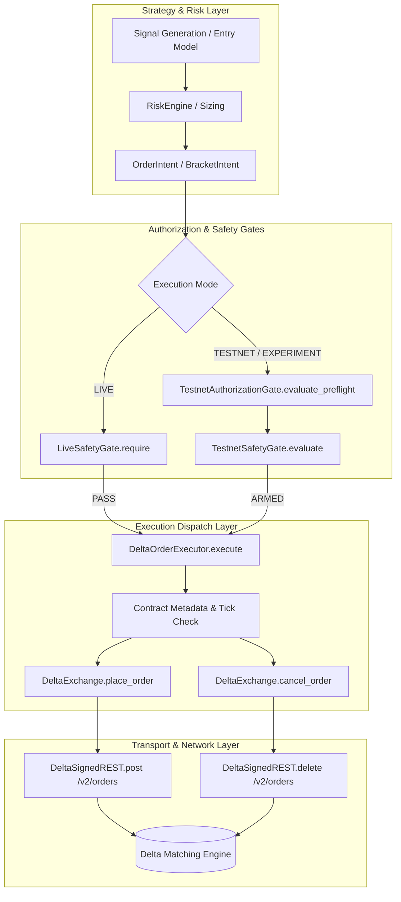

# QuantEngine Phase 189: Order-Writing Call Path Audit & Endpoint Isolation Analysis

**Document**: `reports/PHASE189_ORDER_WRITE_PATH_AUDIT.md`  
**Date**: `2026-10-21`  
**Auditor**: Autonomous Senior Quantitative Engineer & Security Auditor  
**Operating Posture**: `NOT_PRODUCTION_READY` | `EDGE NOT ESTABLISHED`  
**Phase 189 Write Invariant**: Zero Exchange Order Writes (`exchange_order_writes = 0`)  

---

## 1. Executive Summary

This forensic audit identifies, inspects, and maps all exchange order-writing paths across the QuantEngine codebase. It evaluates the structural mechanisms that prevent unauthorized order placement, verifies complete physical and logical isolation from live production venues, and documents residual bypass risks and their hardening controls.

During Phase 189, **zero orders were placed, modified, or cancelled across any network endpoint**.

---

## 2. Order-Writing Call Graph & Architecture

QuantEngine separates order generation from transport dispatch across three distinct architectural layers:



### Detailed Component Inventory:

1. **`core/exchanges/delta/delta_exchange.py`**:
   - `place_order(order)` (Line 117): Dispatches HTTP POST to `/v2/orders`.
   - `cancel_order(order_id, product_id)` (Line 126): Dispatches HTTP DELETE to `/v2/orders` with venue-verified JSON body `{"id": int(order_id), "product_id": int(product_id)}`.
2. **`core/exchanges/delta/delta_auth.py`**:
   - `DeltaSignedREST`: Constructs HMAC-SHA256 signature using API secret, method, path, timestamp, and query/body.
3. **`core/execution/order_executor.py`**:
   - `DeltaOrderExecutor.execute(intent, contract, safety)`: Validates tick size, price precision, minimum lot, gross economics hurdle, and checks safety decision.
   - `DeltaOrderExecutor.cancel(order_id, symbol, safety)`: Dispatches cancel request through exchange adapter.
4. **`core/execution/live_safety_gate.py`**:
   - Pure, fail-closed gate. Rejects any live order unless `mode == LIVE`, `ALLOW_LIVE == True`, `LIVE_EXECUTE == True`, valid credentials exist, and stamps verdict with an unforgeable process-local mint token (`_MINT`).
5. **`core/execution/testnet_safety_gate.py`**:
   - Pure, fail-closed gate for demo/testnet. Validates mode, boolean opt-ins (`ALLOW_TESTNET`, `TESTNET_EXECUTE`), price geometry, stop risk, and rejects `FORBIDDEN_PRODUCTION_URLS`.
6. **`core/execution/testnet_authorization_gate.py` (Phase 189 Enhanced)**:
   - Validates operator authorization documents. Rejects templates in `PENDING_OPERATOR_APPROVAL` state.
   - Enforces persistent cumulative order limits across process crashes.
   - Latching kill switch halts order submission upon anomalous market behavior or manual operator trip.

---

## 3. Dedicated Scripts with Order-Writing Capabilities

An exhaustive repository search identified only two scripts with code capable of submitting live network orders:

| Script Path | Purpose | Execution Guard / Authorization Mechanism |
| :--- | :--- | :--- |
| `scripts/bounded_testnet_order_experiment.py` | Bounded 2-order testnet calibration fill acquisition | Requires explicit `--execute` flag (defaults to `--dry-run`); rejects execution unless `DELTA_INDIA_TESTNET_API_KEY` and secret are loaded; hard-coded max 2 orders; max $200 notional; testnet endpoint verification. |
| `scripts/bounded_testnet_reconciled_experiment.py` | Bounded testnet experiment with concurrent private WS fill capture | Inherits all safety bounds from `bounded_testnet_order_experiment.py`; requires `--execute`; scrubs credentials from WS frames before logging. |

*Note: `scripts/run_phase185_execution_experiment.py` operates exclusively in `QueueAwarePaperExecutionEngine` and performs ZERO network I/O.*

---

## 4. Endpoint Isolation & Verification

### Authoritative URL Whitelist & Blacklist:

```python
# Allowed Testnet REST URLs:
ALLOWED_TESTNET_REST_URLS = frozenset({
    "https://cdn-ind.testnet.deltaex.org",
    "https://testnet-api.delta.exchange",
})

# Forbidden Production REST & WS URLs:
FORBIDDEN_PRODUCTION_URLS = frozenset({
    "https://api.delta.exchange",
    "https://india.delta.exchange",
    "wss://public-socket.delta.exchange",
    "wss://socket.delta.exchange",
})
```

### Verification in Phase 189:
Any attempt to submit an order or evaluate a safety gate targeting a production URL triggers an immediate, unhandled `ProductionEndpointAttemptedError`:
```python
if url_clean in FORBIDDEN_PRODUCTION_URLS:
    raise ProductionEndpointAttemptedError(
        f"CRITICAL SAFETY VIOLATION: Production endpoint {url_clean!r} attempted!"
    )
```
This is verified by 100% passing tests in `tests/test_phase188_gated_execution_mock.py` and `tests/test_phase189_authorization_preflight.py`.

---

## 5. Residual Bypass Risks & Mitigating Controls

| Identified Risk | Failure Mode | Phase 189 Mitigating Control |
| :--- | :--- | :--- |
| **1. Process Restart Counter Reset** | In-memory `orders_submitted` counter resets to 0 if engine crashes or restarts, allowing > 20 cumulative orders. | `TestnetAuthorizationGate.read_cumulative_orders_from_ledger()` queries persistent append-only JSONL file on disk. Restarts maintain cumulative count. |
| **2. Unchecked Authorization Template** | Script looks for existence of `reports/PHASE189_TESTNET_AUTHORIZATION.md` and proceeds even if it contains unpopulated placeholders. | `parse_authorization_document()` performs regex inspection for `[OPERATOR_...]` placeholders and `PENDING_OPERATOR_APPROVAL` string, failing closed. |
| **3. Ambiguous Ack Retries** | Network timeout during `POST /v2/orders` ack causes blind retry, resulting in unintended double exposure. | 5.0s ack timeout transitions order to `AMBIGUOUS_STATE`, halting all new submissions until active `GET /v2/orders` reconciliation completes. |
| **4. Late Fill Inventory Creep** | Limit order reaches 120s timeout, cancel sent, but fill occurs before cancel matches; position left unhedged. | Late fill is recognized in `register_order_terminal(..., FILLED_POST_CANCEL_REQ)` and triggers immediate reduce-only protective exit bracket. |
| **5. Post-Only Market Conversion** | Aggressive limit order crosses spread; venue rejects; naive engine converts to market order. | Strictly prohibited by policy and code; post-only rejection immediately marks order `REJECTED_POST_ONLY` without retry. |

---

## 6. Audit Verdict

- **Order-Writing Paths Identified**: Fully mapped and audited.
- **Production Endpoint Isolation**: Physically and logically verified with typed exceptions.
- **Bypass Controls**: Hardened across restarts, timeouts, templates, and late fills.
- **Phase 189 Exchange Order Writes**: **0 (Zero)**.
