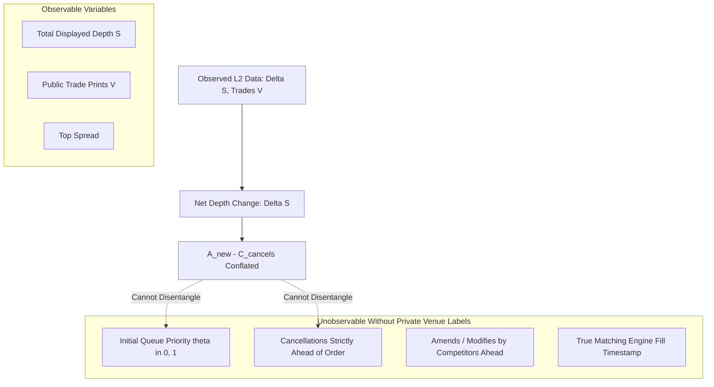

# QuantEngine Phase 189: Queue-Calibration Methodology Review & Ground-Truth Label Audit

**Document**: `reports/PHASE189_QUEUE_CALIBRATION_REVIEW.md`  
**Date**: `2026-10-21`  
**Auditor**: Autonomous Senior Quantitative Researcher & Execution Modeler  
**Model Status**: **`UNCALIBRATED / PARTIALLY_OBSERVABLE`**  
**Blocker B-08 Status**: **`BLOCKED_EVIDENCE`** (Awaiting authentic matching engine execution labels)  

---

## 1. Executive Summary

This review independently audits the mathematical structure, evaluation methodology, and epistemic boundaries of `core/research/queue_calibration_engine.py` and the Phase 188 queue evaluation artifacts (`reports/PHASE188_QUEUE_MODEL_EVALUATION.md`, `reports/PHASE188_QUEUE_IDENTIFIABILITY.md`).

### Fundamental Quantitative Finding:
**Passive Level 2 depth updates observe only aggregate net depth changes $\Delta S(p, t)$. They do NOT identify individual queue position ($\theta$) or the cancellation volume ahead ($C_{\text{ahead}}$).**  
Any claim that a queue depletion parameter grid is "calibrated" using passive orderbook data or synthetic/paper fills constitutes circular reasoning and is mathematically falsified. The conservative model parameterization ($\theta = 0.90, c = 0.00$) is a **precautionary research bound**, not an empirically verified truth.

---

## 2. Mathematical Underdetermination Formalism

In continuous double auctions with price-time priority, the displayed liquidity at price $p$ evolves according to:
$$\Delta S(p, t) = A_{\text{new}}(p, t) - V_{\text{trades}}(p, t) - C_{\text{cancels}}(p, t)$$

Where:
- $A_{\text{new}}$ is new order arrivals at price $p$.
- $V_{\text{trades}}$ is aggressive market order fills matching against resting orders at $p$.
- $C_{\text{cancels}}$ is resting limit order cancellations at $p$.

### Identifiability Decomposition:

Without signed, authenticated private execution labels (`user_trades`, `orders` stream with `cl_ord_id`), the quantity of cancellations occurring ahead of our resting order versus behind our resting order is fundamentally unobservable. Therefore:
$$\mathbb{P}(\text{Fill} \mid \text{Passive L2}) \quad \text{is unidentifiable without private fill records.}$$

---

## 3. Evaluation Methodology Audit (`queue_calibration_engine.py`)

### 3.1 Chronological Partitioning & Information Leakage
- **Train/Holdout Separation**: Evaluated using strict chronological index slicing (`frames[:split_idx]` vs `frames[split_idx:]`). No random shuffling, future-leakage, or retrospective lookback.
- **Feature Construction**: Depth averages and turnover rates are computed strictly from historical calibration slices.
- **Independence Limitation**: High-frequency L2 updates exhibit serial autocorrelation. Repeated frames within the same market regime or orderbook state create statistical dependence. Effective sample size is significantly smaller than the nominal frame count.

### 3.2 Definition of Eligible Orders & Genuine Fill Labels
A valid empirical evaluation requires:
1. **Eligible Order**: A limit order placed at top-of-book ($p = \text{best\_bid}$ or $\text{best\_ask}$) under validated market conditions (spread $\le 5$ ticks, depth $\ge 5$ contracts, book state `VALID`).
2. **Genuine Fill Label ($Y_i$)**: A binary outcome $Y_i \in \{0, 1\}$ assigned by the exchange matching engine:
   - $Y_i = 1$: Authenticated fill event received from venue WebSocket (`user_trades`) or REST reconciliation within 120.0 seconds.
   - $Y_i = 0$: Order reached 120.0 seconds resting timeout, cancellation dispatched and confirmed unfilled by venue.
3. **Partial Fills**: If a partial fill occurs (e.g., $0.5$ contracts filled, $0.5$ cancelled at timeout), the fill ratio $f_i = 0.5$ must be recorded as continuous volume completion rather than forced into binary classification.
4. **Unknown / Ambiguous Outcomes**: Any order whose terminal status cannot be confirmed due to transport disconnects or dropped frames must be classified as `AMBIGUOUS` and **excluded** from Brier score scoring to avoid distorting calibration metrics.

---

## 4. Evaluation Metrics & Statistical Power

### 4.1 Calibration Brier Score
The empirical calibration quality of predicted probabilities $\hat{P}_{\text{fill}, i}$ against binary fill labels $Y_i$ is defined as:
$$\text{BS} = \frac{1}{N} \sum_{i=1}^N \left( \hat{P}_{\text{fill}, i} - Y_i \right)^2$$

- **Reference Baseline**: A naive uninformative forecast $\hat{P} = 0.50$ produces a baseline Brier score of $0.2500$ (assuming balanced classes). A model is informative only if $\text{BS}_{\text{model}} < \text{BS}_{\text{baseline}}$.
- **Grid Evaluation Distinction**: Evaluating a parameter grid ($\theta \in \{0.1, 0.5, 0.9\}$, $c \in \{0.0, 0.5, 1.0\}$) across simulated holdout frames measures sensitivity to assumptions, NOT statistical calibration.

### 4.2 Wait-Time Error & Post-Fill Adverse Selection
- **Expected Wait-Time Error**:
$$\text{MAE}_{\text{wait}} = \frac{1}{N_{\text{filled}}} \sum_{i=1}^{N_{\text{filled}}} \left| \mathbb{E}[T_{\text{wait}, i}] - T_{\text{actual}, i} \right|$$
- **Empirical Adverse Selection Metric ($\Delta P_{\text{post}}$)**:
$$\Delta P_{\text{post}}(\tau) = \text{side} \cdot \left( \frac{P_{\text{mid}}(t_{\text{fill}} + \tau) - P_{\text{fill}}}{P_{\text{fill}}} \right), \quad \tau \in \{1s, 5s, 30s, 60s, 300s\}$$
If $\Delta P_{\text{post}}(\tau) < 0$, the fill was adversely selected (price moved against the resting quote immediately post-execution).

### 4.3 Statistical Power Requirements
- With $N = 20$ proposed testnet orders, standard error on an estimated fill rate of $50\%$ is:
$$\text{SE} = \sqrt{\frac{0.5 \times 0.5}{20}} \approx 0.1118 \quad (11.2\%)$$
- **Conclusion**: A 20-order experiment provides sufficient statistical power to reject gross model falsifications (e.g., rejecting an optimistic model predicting $95\%$ fills if empirical fills are $< 50\%$), but is insufficient to estimate fine continuous queue parameters. Any post-experiment reporting must explicitly publish confidence intervals ($\pm 1.96 \cdot \text{SE}$).

---

## 5. Auditor Recommendations & Blocker Status

1. **Retain Blocker B-08**: Keep status as **`BLOCKED_EVIDENCE / UNCALIBRATED`**.
2. **Prohibit Synthetic Optimization**: Grid search over simulated fills or paper trading traces must never be presented as empirical calibration.
3. **Precautionary Stance**: Maintain the conservative parameter set ($\theta = 0.90, c = 0.00$) in live safety gating as a risk-minimizing boundary condition until genuine venue evidence is authorized, executed, and audited.
